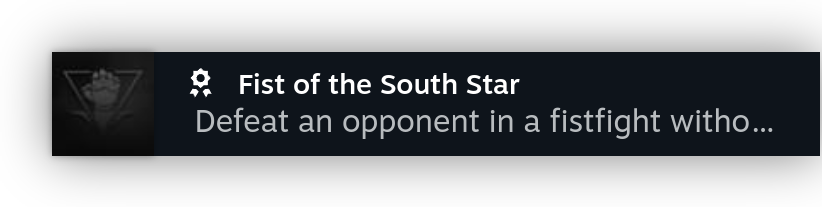
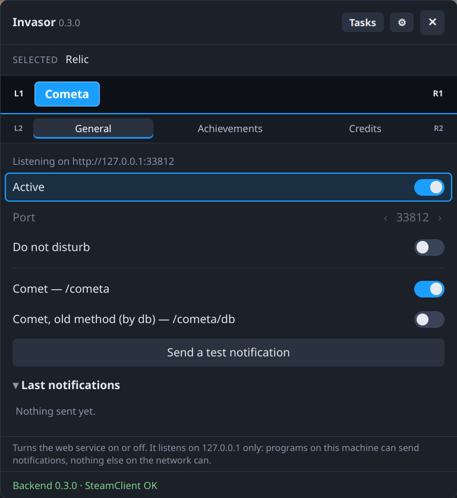
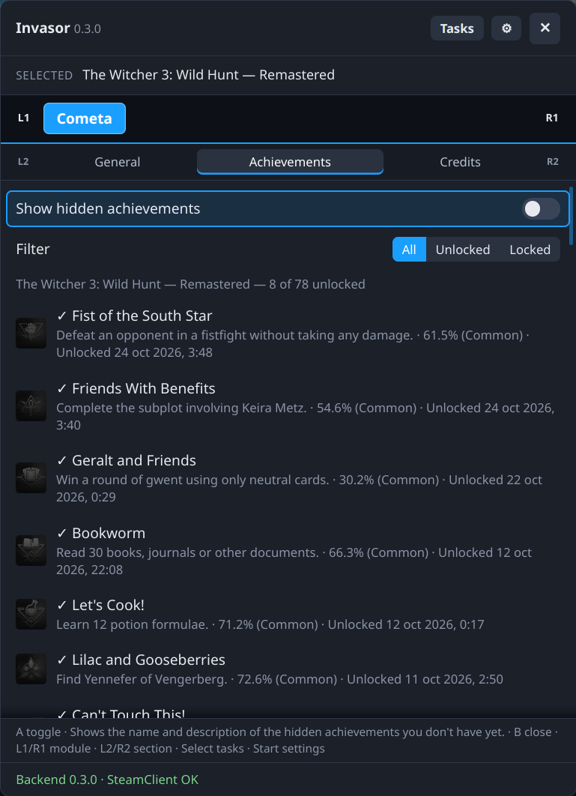

# Cometa

A module for [Invasor](../invasor) that shows the **achievements of GOG games run through [Comet](https://github.com/imLinguin/comet)** as Steam notifications, in Game Mode and Big Picture. Split from Noty, together with [Popy](https://github.com/Gamemode-Invasor/invasor-popy).

Cometa listens on **127.0.0.1** only (port 33812 by default; turn the service off in its tab to change it). Each endpoint can be turned off in the tab.

| Endpoint | Payload |
|---|---|
| `/cometa` | The `custom_event` Comet itself POSTs: `{"name": "achievement_unlocked", "client_id", "data": {…achievement…}}`. Needs a Comet with `custom_event`. |
| `/cometa/db` | The old, alternative method, off by default: the unlocked achievement as a flat JSON object, sent by Comety from Comet's database. |

The notification takes the achievement's `name` as the title, its `description` and `rarity` as the body and `image_url_unlocked` as the icon, with Steam's trophy sound. An achievement from `/cometa` is always shown: Comet sends it only for a new unlock, and its date is the game's, which stands still while the machine sleeps. From `/cometa/db`, only an achievement unlocked in the last 5 minutes is shown; anything else is answered `ignored`.

When a GOG game (a Steam shortcut whose `.bat` has `set "STORE=gog"`, as [Rakun](https://github.com/FranjeGueje/rakun) writes it) is selected or starts, Cometa writes this block in Comet's `config.toml` of the game's prefix, keeping the rest of the file:

```toml
# cometa:begin (written by Cometa, replaced every time)
[[custom_event]]
enabled = true
url = "http://127.0.0.1:33812/cometa"
# cometa:end
```

When the game starts, Cometa checks that the config has that URL, that the game's `comet.exe` is running and that it holds Comet's port (9977), and tells you if something is missing.

When `/cometa/db` is on, Cometa runs **Comety** (`bin/comety`, x86-64; its source is in [`comety/`](comety/)) for each `gameplay.db` of the game being played. Turn it on only if `/cometa` doesn't work: with both on, an achievement shows twice.

The **Achievements** tab shows the achievements Comet keeps for the current GOG game (the open page, else the highlighted tile, else the game being played), one list per `gameplay.db` of its prefix (grouped only when there is more than one): unlocked and locked, with their description, rarity and when they were unlocked. Hidden achievements you don't have yet stay hidden unless you turn on "Show hidden achievements". **Filter** (←→) shows all of them, only the unlocked or only the locked. In Quick Access, Cometa only shows while a GOG game is being played.

## Screenshots

<p align="center">
  
</p>

<p align="center">
  
  
</p>

## Requirements
Invasor 0.3.0 or newer (`min_core`): it uses `ctx.paths` to find a game's prefix in whichever library holds it.

## Build, test and install
With the core checked out next to this repository (`../invasor`):

```sh
python3 ../invasor/tools/pack_module.py cometa       # build, check, tests -> cometa-<version>.zip
python3 ../invasor/tools/install_module.py cometa    # or install that zip from ⚙ Settings › Install module
```

## Changes

### 0.2.1
- `/cometa` shows every achievement Comet sends, however old its date. An achievement unlocked after suspending the machine with the game open wasn't shown: the game's clock stands still while it sleeps, so it looked old.
- `/cometa/db` logs each old unlock it ignores, with its age.

### 0.2.0
- A GOG game in another library (an SD card, a USB drive) is found too: its Comet config, its databases and its achievements. Before, only the main library was looked at.
- Needs Invasor 0.3.0.

### 0.1.0
- First release.

## Credits
[Comet](https://github.com/imLinguin/comet) by imLinguin and its contributors, under the Apache License 2.0. Cometa is not affiliated with Comet or imLinguin. Please don't report problems with this module to them.

## License
[GNU General Public License v3.0 or later](LICENSE) (GPL-3.0-or-later).
